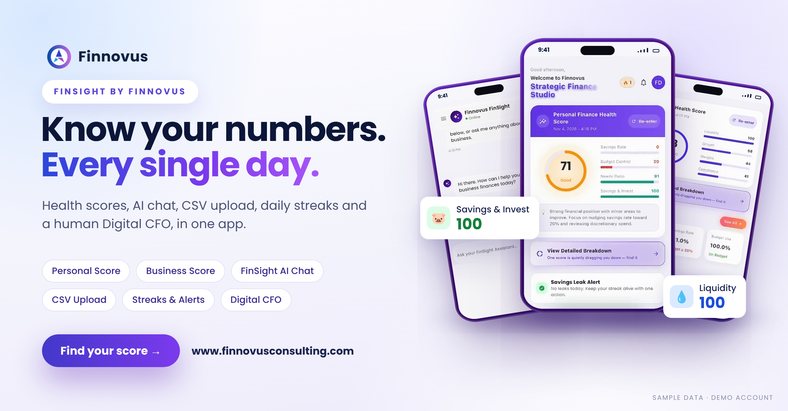
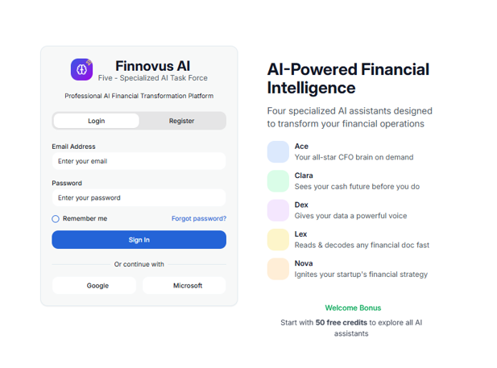

<div align="center">

```
 █████╗ ██████╗ ███╗   ██╗ █████╗ ███╗   ██╗
██╔══██╗██╔══██╗████╗  ██║██╔══██╗████╗  ██║
███████║██║  ██║██╔██╗ ██║███████║██╔██╗ ██║
██╔══██║██║  ██║██║╚██╗██║██╔══██║██║╚██╗██║
██║  ██║██████╔╝██║ ╚████║██║  ██║██║ ╚████║
╚═╝  ╚═╝╚═════╝ ╚═╝  ╚═══╝╚═╝  ╚═╝╚═╝  ╚═══╝
███████╗ █████╗ ██╗      █████╗ ████████╗
██╔════╝██╔══██╗██║     ██╔══██╗╚══██╔══╝
███████╗███████║██║     ███████║   ██║
╚════██║██╔══██║██║     ██╔══██║   ██║
███████║██║  ██║███████╗██║  ██║   ██║
╚══════╝╚═╝  ╚═╝╚══════╝╚═╝  ╚═╝   ╚═╝
```

<a href="https://github.com/madnansaleem707"></a>


</div>

<table>
<tr>
<td width="46%">
<picture>
  <source media="(prefers-color-scheme: dark)" srcset="portrait-dark.png">
  
</picture>
</td>
<td>

```text
adnan@finnovus
──────────────────────────────
Role ····· Founder & MD, Finnovus
Creds ···· FCCA (UK) · CFA
Award ···· ACCA Inspiring
           Professional 2024/25
Exp ······ Deloitte · Equinix
           SS&C · IBEX
Base ····· Karachi, Pakistan
Markets ·· US · UK · GCC
Building · FinSight
           Finnovus Five
           StrategyFlow_COS
Motto ···· Human + AI in
           ethical finance
```

</td>
</tr>
</table>

### ~/projects

```
├── finnovus-finsight    Personal & business finance app · Flutter · live
├── finnovus-five        Five AI agents working as one finance team
├── strategyflow-cos     Market news in, scored opportunities out · vLLM
└── invoice-automation   Invoice → reminders → bank recon → ERP sync
```

<details>
<summary><b>📱 Finnovus FinSight</b>: finance platform for individuals and businesses</summary>
<br>

- Personal and business financial health tools, with FinSight AI built in
- Reports, invoices, products and services, referrals and profile management
- Separate Flutter web app for internal administration
- Built with Flutter · Live on [Google Play](<link>) and the [App Store](<link>)



</details>

<details>
<summary><b>🤖 Finnovus Five</b>: an AI task force of five specialized agents</summary>
<br>

| Agent | Role |
|---|---|
| **Nova** | Predictive insights, pattern recognition and advisory recommendations |
| **Dex** | Data extraction, processing and report formatting |
| **Hannan** | Tax across the USA (California, Florida), Pakistan (federal, Punjab, Sindh, KPK, Balochistan, FBR, SROs, finance acts) and the UK (HMRC: income tax, corporation tax, VAT, reliefs) |
| **Addy** | Technology and AI automation: automations, coding help and production deployment |
| **Captain** | Chief of staff to the founder: operations, cyber security and attack prevention |



[Repo or demo link]

</details>

<details>
<summary><b>📈 StrategyFlow_COS</b>: an always-on AI business analyst</summary>
<br>

- Collects daily signals from RSS feeds, Google News, NewsData.io and FX rates
- Tracks the competitors you define: offering, pricing, speed, strengths and weaknesses
- Runs an open-source LLM on vLLM and AMD Instinct GPUs to find underserved needs and competitor gaps
- Scores each opportunity 0 to 100, with what's changing, what's missing and what a business could build
- Daily report in a web console and by email, with history for trend tracking · Self-hosted

[→ View repo](https://github.com/madnansaleem707/strategyFlow_COS)

</details>

<details>
<summary><b>🧾 Invoice Automation</b>: end-to-end accounts receivable</summary>
<br>

- Creates invoices and maps them to customers
- Sends by aging days, with automated follow-ups and payment reminders
- Reconciles against the bank ledger and updates receivable heads automatically
- Pushes updates to any ERP system via API

[Repo or demo link]

</details>

### 🛠 Stack


[add your languages, databases and cloud here]

### 📫 Reach me

<a href="<linkedin url>"></a>
<a href="<finnovus url>"></a>
<a href="mailto:<email>"></a>
